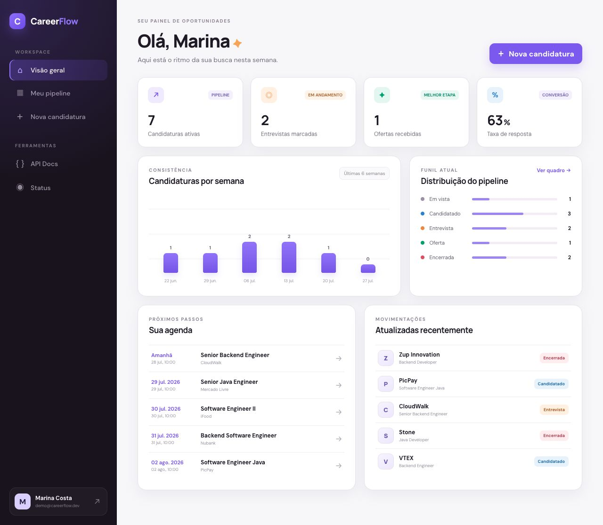
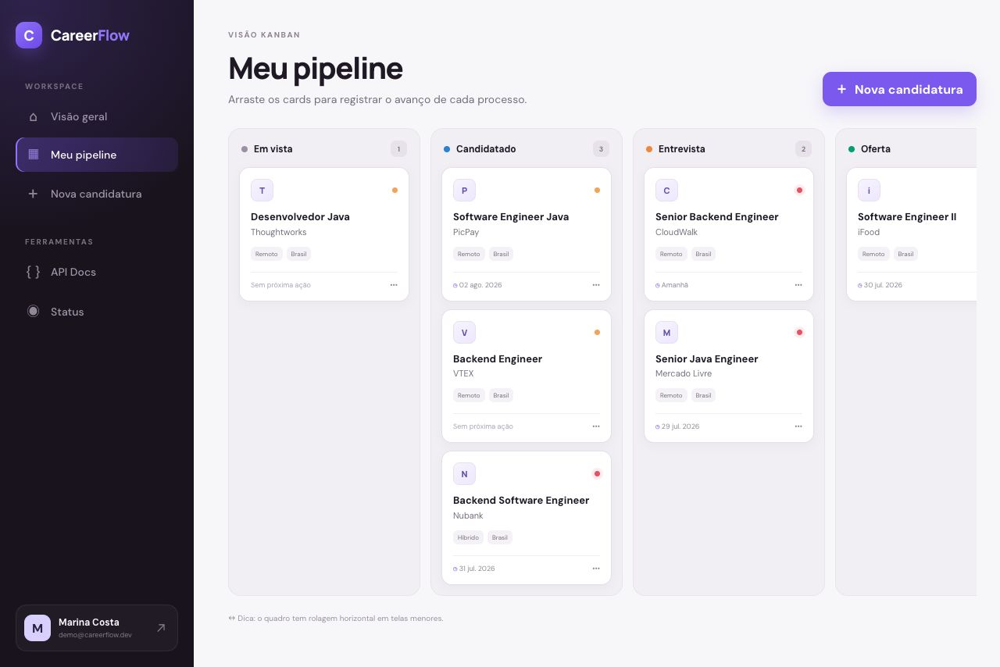
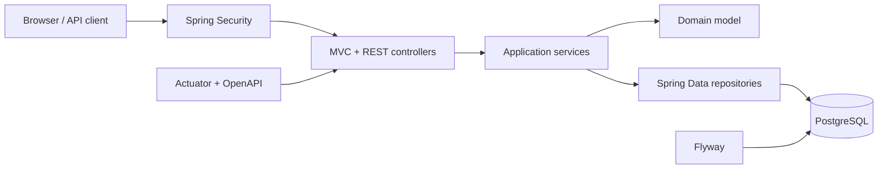

<div align="center">
  
  <h1>CareerFlow</h1>
  <p><strong>Um dashboard de inteligência para transformar candidaturas em um processo organizado, mensurável e acionável.</strong></p>

  <p>
    
    
    
    
    
  </p>
</div>



## Por que este projeto existe

Planilhas ajudam a guardar vagas; o CareerFlow ajuda a tomar decisões. A aplicação reúne candidaturas, etapas do processo, prioridades, faixa salarial, próximos passos e histórico em um workspace visual.

Para quem avalia o código, o projeto demonstra mais do que CRUD:

- regras de domínio encapsuladas e casos de uso transacionais;
- autenticação, autorização e isolamento de dados por usuário;
- API REST com erros no padrão RFC 9457 e documentação OpenAPI;
- migrações versionadas executadas em H2 e PostgreSQL;
- testes de domínio, serviço, MVC, segurança e integração com Testcontainers;
- interface responsiva renderizada no servidor e Kanban com drag-and-drop;
- observabilidade com health check e métricas;
- entrega reproduzível com Docker, Compose e GitHub Actions.

## Experiência do produto

### Dashboard acionável

Métricas de candidaturas ativas, entrevistas, ofertas e taxa de resposta, com evolução semanal e agenda de follow-ups.

### Pipeline visual



Cinco etapas, prioridades visuais e movimentação de cards com atualização via API e registro automático no histórico.

### Detalhes que fazem diferença

- cadastro e login com senha protegida por BCrypt;
- formulário completo com validação no cliente e servidor;
- controle otimista de concorrência com `@Version`;
- linha do tempo auditável por candidatura;
- dados de demonstração prontos para avaliação;
- design responsivo sem depender de um framework JavaScript.

## Arquitetura

O código é organizado por funcionalidade, mantendo domínio, aplicação e interfaces próximos. Isso reduz acoplamento entre módulos sem criar cerimônia desnecessária.



```text
src/main/java/com/careerflow
├── application/   # domínio, casos de uso, MVC e API de candidaturas
├── auth/          # conta, registro e identidade do usuário atual
├── dashboard/     # métricas e composição da visão geral
└── common/        # segurança, OpenAPI, dados demo e erros compartilhados
```

Veja as decisões e os limites do desenho em [docs/architecture.md](docs/architecture.md).

## Stack

| Camada | Tecnologia |
|---|---|
| Linguagem | Java 21 |
| Aplicação | Spring Boot 4.1, Spring MVC |
| Persistência | Spring Data JPA, Hibernate, Flyway |
| Banco | PostgreSQL 17; H2 no modo demo |
| Segurança | Spring Security, BCrypt, CSRF |
| Front-end | Thymeleaf, CSS responsivo, JavaScript sem framework |
| API | REST, OpenAPI 3, Swagger UI |
| Qualidade | JUnit 5, AssertJ, Mockito, MockMvc, Testcontainers, JaCoCo |
| Operação | Actuator, Docker, Docker Compose, GitHub Actions |

## Rodando em 30 segundos

### Opção 1 — modo demo

Requer apenas Java 21:

```bash
./mvnw spring-boot:run
```

Acesse [http://localhost:8080](http://localhost:8080) e use:

```text
E-mail: demo@careerflow.dev
Senha:  demo123
```

O perfil padrão usa H2 em memória e carrega dados de demonstração automaticamente.

### Opção 2 — aplicação e PostgreSQL com Docker

```bash
docker compose up --build
```

O Compose cria o banco, aguarda o health check, executa as migrações e inicia a aplicação na porta `8080`.

Para ambiente real, copie `.env.example`, use segredos fortes e mantenha `DEMO_DATA=false`.

## API

Depois de entrar na aplicação, a documentação interativa fica em:

- Swagger UI: [http://localhost:8080/docs](http://localhost:8080/docs)
- OpenAPI JSON: [http://localhost:8080/api-docs](http://localhost:8080/api-docs)
- Health check: [http://localhost:8080/actuator/health](http://localhost:8080/actuator/health)

| Método | Endpoint | Ação |
|---|---|---|
| `GET` | `/api/v1/applications` | lista o pipeline do usuário |
| `GET` | `/api/v1/applications/{id}` | busca uma candidatura |
| `POST` | `/api/v1/applications` | cria uma candidatura |
| `PATCH` | `/api/v1/applications/{id}/status` | move uma candidatura |
| `DELETE` | `/api/v1/applications/{id}` | remove uma candidatura |

Exemplos prontos estão em [docs/api-examples.http](docs/api-examples.http).

## Testes e qualidade

```bash
# suíte rápida
./mvnw test

# suíte completa, incluindo PostgreSQL real em container
./mvnw verify -Pintegration-tests

# relatório de cobertura
open target/site/jacoco/index.html
```

O pipeline de CI executa a suíte completa e também comprova que a imagem Docker continua construindo.

## Configuração

| Variável | Padrão | Descrição |
|---|---|---|
| `SPRING_PROFILES_ACTIVE` | `demo` | use `prod` com PostgreSQL |
| `DATABASE_URL` | `jdbc:postgresql://localhost:5432/careerflow` | URL JDBC |
| `DATABASE_USERNAME` | `careerflow` | usuário do banco |
| `DATABASE_PASSWORD` | `careerflow` | senha do banco |
| `REMEMBER_ME_KEY` | chave local insegura | segredo para cookies persistentes |
| `DEMO_DATA` | `false` em produção | cria usuário e pipeline de exemplo |
| `PORT` | `8080` | porta HTTP |

## Ideias para próximas versões

- notificações por e-mail para follow-ups vencendo;
- importação de vagas a partir de CSV;
- comparação de propostas com compensação total;
- exportação de métricas para Prometheus;
- autenticação social com OAuth 2.0.

## O que aprendi

Construir o CareerFlow reforçou decisões que aparecem em sistemas de produção:
modelar transições de estado no domínio, isolar dados por usuário em todas as
consultas, preservar a integridade do banco com migrações e testar a aplicação
em diferentes níveis. Também exercitei o equilíbrio entre uma interface bem
acabada e uma arquitetura simples o bastante para continuar evoluindo.

Uma descrição curta para o repositório:

> Job application intelligence dashboard built with Java 21, Spring Boot, PostgreSQL, Testcontainers and a polished server-rendered UI.

Uma frase pronta para o currículo:

> Desenvolvi um sistema multiusuário de gestão de candidaturas com Java 21 e Spring Boot, aplicando segurança, migrações PostgreSQL, API REST documentada, testes de integração com Testcontainers e CI/CD com Docker.

## Licença

Distribuído sob a licença [MIT](LICENSE).
