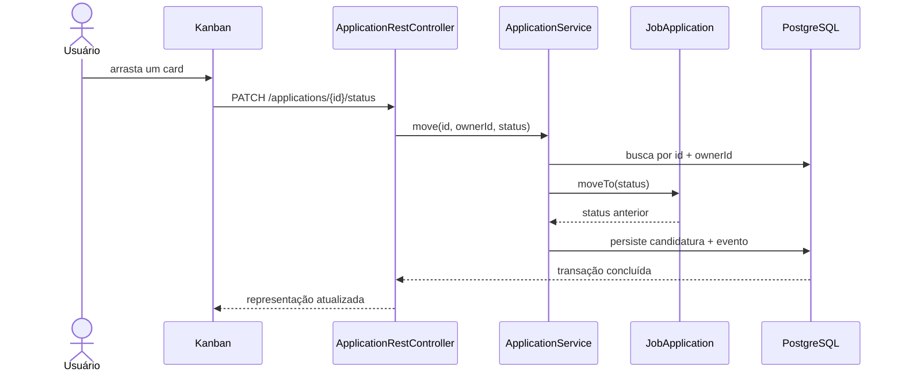

# Arquitetura do CareerFlow

## Objetivos

O desenho prioriza quatro qualidades:

1. leitura rápida por quem está conhecendo o repositório;
2. regras de negócio protegidas dentro do domínio;
3. facilidade para testar casos de uso sem subir a aplicação inteira;
4. evolução gradual sem antecipar uma arquitetura distribuída.

## Organização por funcionalidade

Em vez de separar todo o projeto em pastas globais como `controller`, `service` e `repository`, cada funcionalidade mantém seus componentes próximos:

- `application`: ciclo de vida de uma candidatura;
- `auth`: conta, registro e resolução do usuário autenticado;
- `dashboard`: consultas e métricas derivadas;
- `common`: infraestrutura realmente compartilhada.

Essa abordagem torna claro quais classes mudam juntas e evita dependências acidentais entre funcionalidades.

## Fluxo de uma alteração de status

O filtro por `id` e `ownerId` acontece na consulta. Dessa forma, uma candidatura de outro usuário se comporta como um recurso inexistente e não vaza informação sobre sua existência.

## Consistência

- `@Transactional` delimita os casos de uso.
- A candidatura e o evento de auditoria são gravados na mesma transação.
- `@Version` detecta atualizações concorrentes.
- Flyway é a única autoridade para o schema.
- Hibernate usa `ddl-auto=validate`, falhando cedo quando entidade e migration divergem.

## Perfis

### `demo`

- H2 em memória com compatibilidade PostgreSQL;
- massa de demonstração automática;
- ideal para avaliação local em um comando.

### `prod`

- PostgreSQL configurado por variáveis de ambiente;
- cache de templates habilitado;
- dados demo desabilitados por padrão.

### `test`

- H2 isolado por processo;
- sem massa automática;
- usado nos testes MVC e de persistência.

O teste `PostgresMigrationIT` substitui dinamicamente o datasource por um PostgreSQL real gerenciado pelo Testcontainers.

## Trade-offs conscientes

- Sessões HTTP foram escolhidas no lugar de JWT porque o produto é uma aplicação web first-party. Isso reduz exposição de tokens e mantém proteção CSRF explícita.
- O front-end é server-rendered. O JavaScript fica restrito a interações progressivas, como o drag-and-drop.
- Dashboard e escrita compartilham o mesmo banco. Para a escala atual, separar CQRS ou serviços criaria custo sem ganho concreto.
- Eventos são uma trilha de auditoria, não um event store; o estado atual continua na tabela `job_application`.
